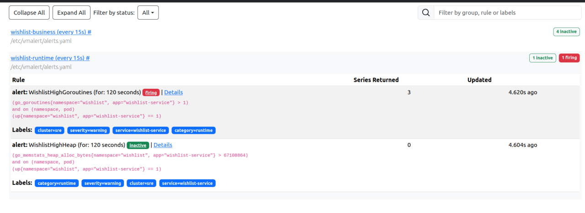
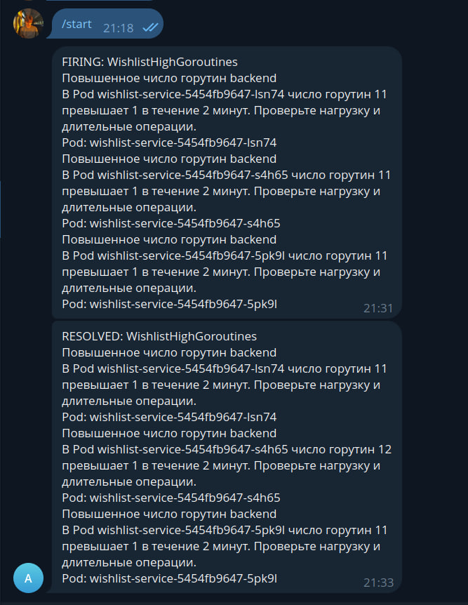
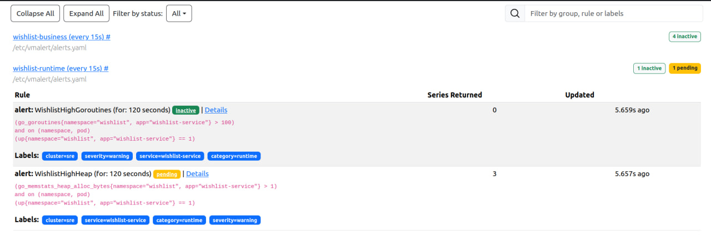
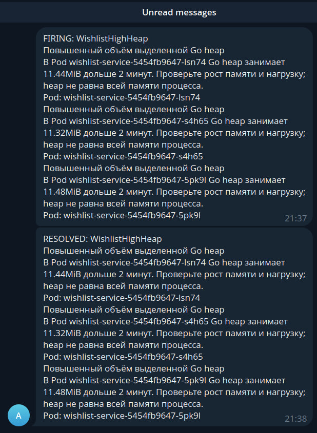
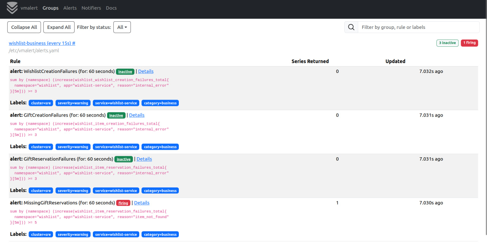
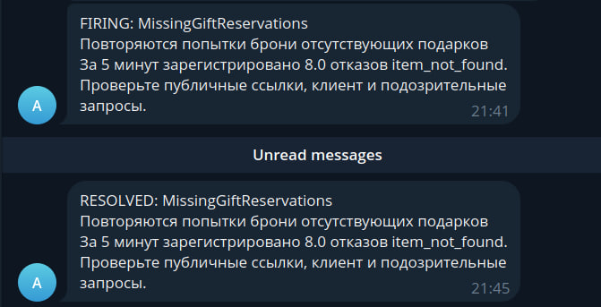
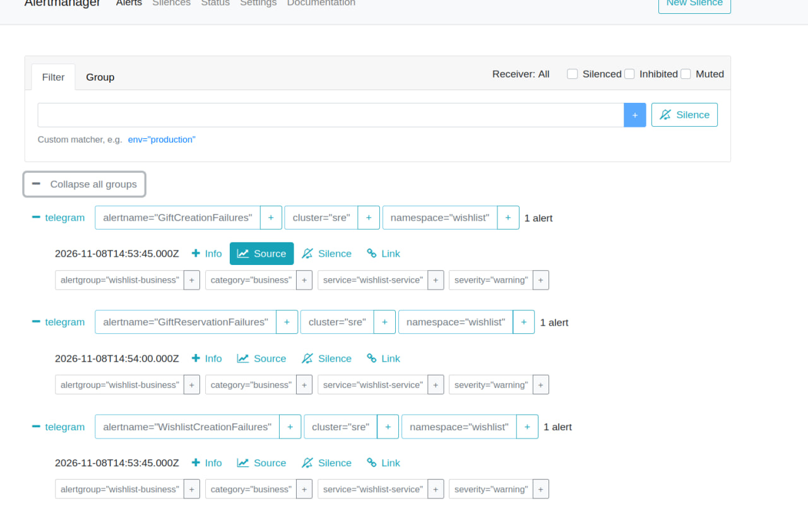
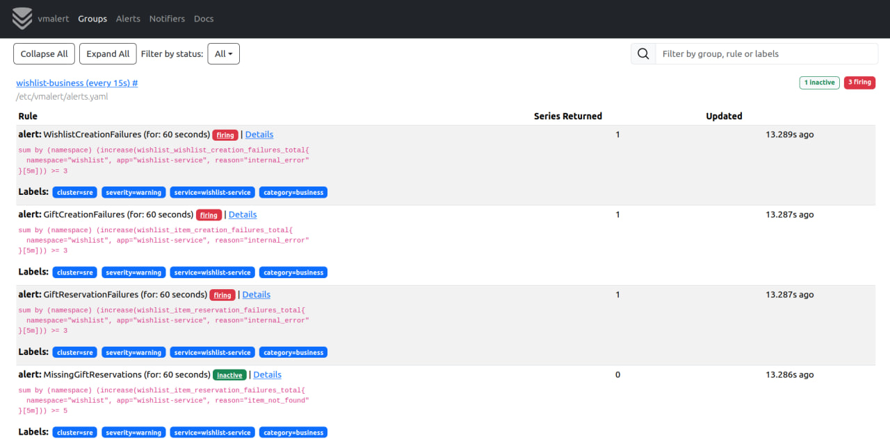
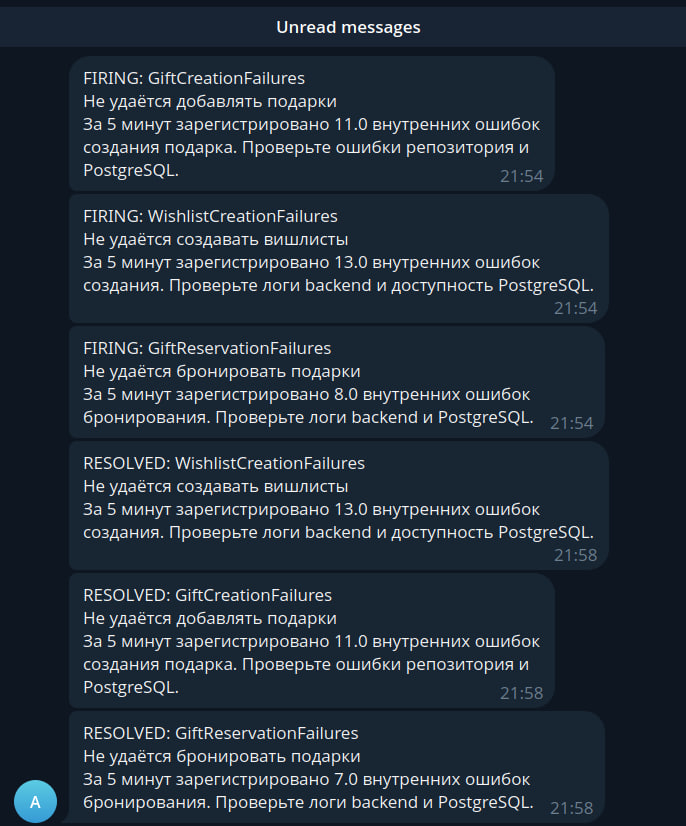

# Алерты Wishlist

Для Wishlist настроил шесть алертов: четыре на бизнес-операции и два на Go runtime. Проверил их срабатывание и получение уведомлений в Telegram, затем восстановление.

## Как это работает

vmagent собирает метрики приложения и отправляет их в VictoriaMetrics. vmalert раз в 15 секунд проверяет правила. Когда условие держится заданное время, отправляет алерт в Alertmanager, а тот — сообщение в Telegram.

Правила находятся в [rules.yaml](rules.yaml), запуск компонентов — в [vmalert.yaml](vmalert.yaml) и [alertmanager.yaml](alertmanager.yaml). Шаблон настройки Telegram — в [alertmanager.example.yaml](alertmanager.example.yaml). Токен хранится в локальном файле и Kubernetes Secret, в репозиторий не добавляется. Команды запуска есть в [README.md](README.md).

Alertmanager группирует уведомления по кластеру, namespace и имени алерта. Перед первым сообщением ждёт 10 секунд, изменения группы отправляет с интервалом 30 секунд. Повтор активного уведомления — через 4 часа. При восстановлении приходит `RESOLVED`.

## Какие условия выбраны

| Алерт | Условие | Время `for` | Зачем |
|---|---|---|---|
| `WishlistCreationFailures` | Не менее 3 внутренних ошибок создания вишлиста за 5 минут | 1 минута | Пользователь не может создать список |
| `GiftCreationFailures` | Не менее 3 внутренних ошибок добавления подарка за 5 минут | 1 минута | Не получается наполнить вишлист |
| `GiftReservationFailures` | Не менее 3 внутренних ошибок бронирования за 5 минут | 1 минута | Не работает основной сценарий выбора подарка |
| `MissingGiftReservations` | Не менее 5 попыток брони отсутствующего подарка за 5 минут | 1 минута | Нужно проверить ссылки, клиент или подозрительные запросы |
| `WishlistHighGoroutines` | Более 100 горутин в одном Pod | 2 минуты | Возможное накопление длительных или зависших операций |
| `WishlistHighHeap` | Выделенная Go heap больше 64 MiB в одном Pod | 2 минуты | Нужно проверить рост памяти приложения |

Все правила имеют уровень `warning`. Это начальные пороги для учебного стенда. Для ошибок выбрал количество за период: при небольшом трафике процент отказов сильно меняется даже от одной ошибки. `for` отсеивает краткие превышения.

Бизнес-счётчики суммируются по репликам через `sum(increase(...))`, чтобы учитывать события разных Pods и сбросы после перезапуска. В первые три правила входят только ошибки с причиной `internal_error`. Неверная дата, отсутствие прав и повторная бронь уже занятого подарка не вызывают эти алерты.

Runtime проверяется отдельно у каждой реплики при успешном сборе метрик (`up=1`). Go heap показывает выделенную память кучи, а не всю память процесса.

## Проверка горутин

Для проверки временно снизил порог со 100 до 1. В трёх репликах было около 11–12 горутин. После двух минут условие перешло в `Firing`.

В Telegram пришло одно сообщение с тремя экземплярами алерта — Alertmanager сгруппировал их по имени правила. После возврата порога 100 пришло `RESOLVED`.

## Проверка памяти

Порог heap временно снизил с 64 MiB до 1 байта. На скриншоте правило ещё в `Pending`: условие уже выполняется, но две минуты ожидания не прошли.

Затем пришло `FIRING`. После возврата порога 64 MiB — `RESOLVED`. Оба runtime-алерта проверялись снижением порогов; искусственную утечку памяти или горутин я не создавал.

## Бронирование отсутствующего подарка

Отправил восемь запросов бронирования с действующим токеном контрольного вишлиста и случайным UUID отсутствующего подарка. Приложение возвращало `404`, счётчик `item_not_found` увеличился. Пороги этого правила не менял.

В Telegram пришло уведомление о восьми отказах. Когда события вышли из пятиминутного окна, пришло сообщение о восстановлении.

## Внутренние ошибки создания и бронирования

Временно уменьшил число реплик PostgreSQL до нуля. К backend подключился напрямую через port-forward к одному Pod: обычный Service после отказа readiness перестаёт направлять в него новые соединения.

В подготовленных вкладках приложения повторил создание вишлиста, добавление подарка и бронирование. Без БД операции возвращали `500` и увеличивали соответствующие счётчики `internal_error`. После запросов вернул PostgreSQL в одну реплику.

Все три алерта появились в Alertmanager:

В vmalert видны условия и состояние `Firing`:

Для каждого правила получил уведомления `FIRING` и `RESOLVED`. После включения БД алерты ещё некоторое время оставались активными: ошибки продолжали попадать в пятиминутное окно расчёта.

