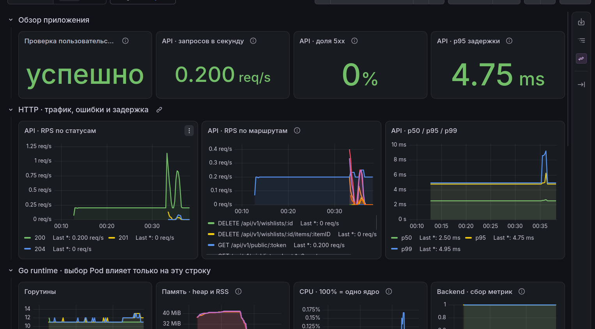
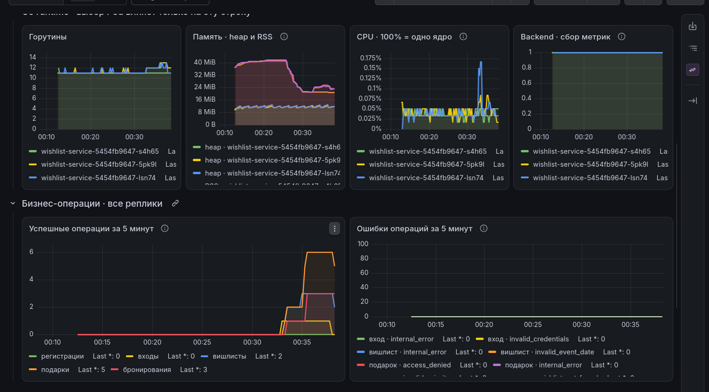
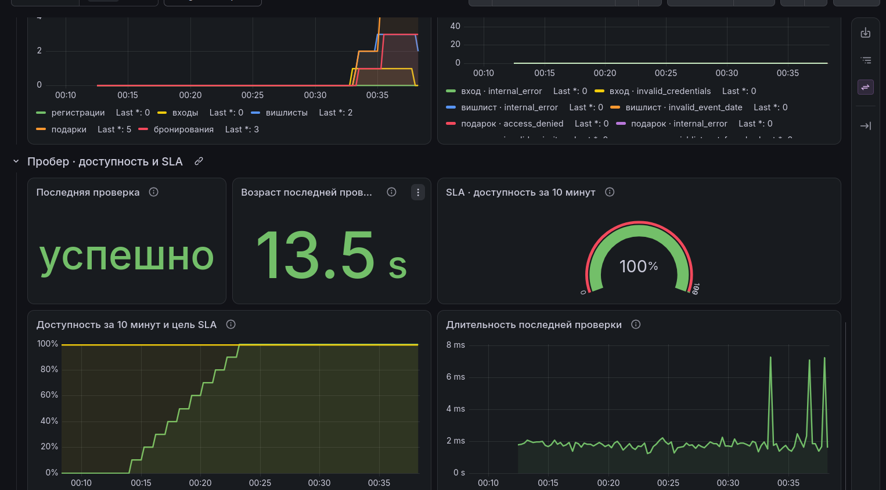
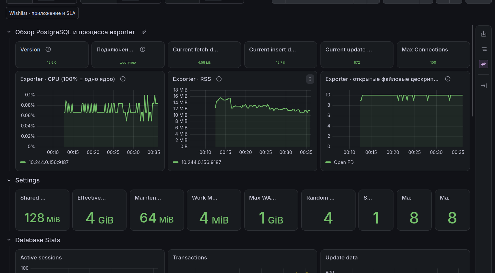
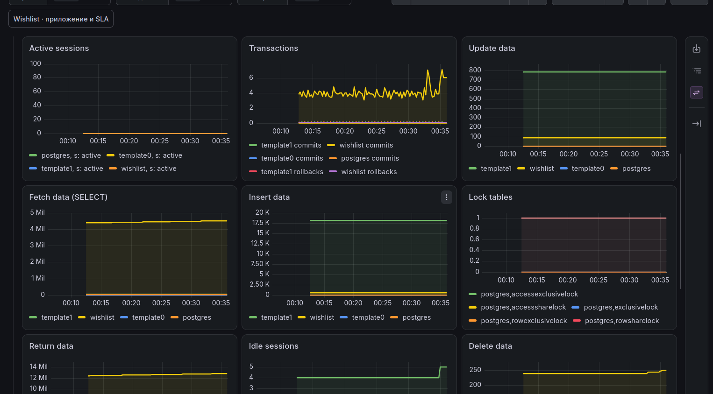
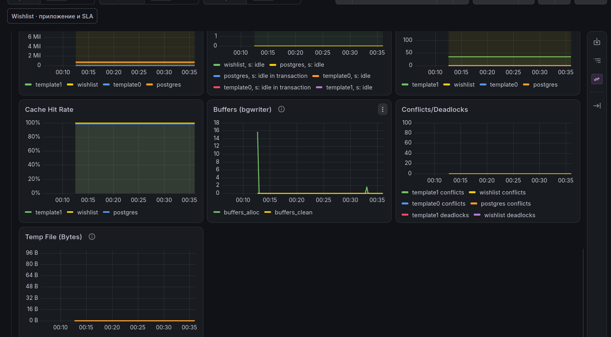

# Дашборды Wishlist в Grafana

Развернул Grafana в minikube через Helm в namespace `monitoring`. Подключил VictoriaMetrics и добавил два дашборда: приложение с пробером и импортированный PostgreSQL Exporter.

## Источник данных

Оба дашборда используют источник **VictoriaMetrics** с адресом `http://victoria-metrics:8428` и встроенным типом Prometheus. vmagent раз в 15 секунд собирает метрики backend, postgres-exporter и пробера. Grafana читает уже сохранённые данные.

Метрики Go runtime и процесса отдают стандартные сборщики библиотеки Prometheus. HTTP-метрики и бизнес-счётчики добавлены в приложении. Статистику PostgreSQL получает postgres-exporter.

## Приложение

Для HTTP использовал подход RED: частота запросов, ошибки и длительность. Сверху расположены текущее состояние и основные показатели, ниже — детализация для поиска причин.

| Панели | Метрики и назначение |
|---|---|
| Доступность сценария | `wishlist_probe_success` — удалось ли прочитать контрольный вишлист через Service и БД |
| RPS и статусы | `rate(wishlist_http_requests_total)` — интенсивность запросов, распределение по статусам и маршрутам |
| Доля `5xx` | Доля серверных ошибок в общем числе API-запросов |
| p50, p95 и p99 | `wishlist_http_request_duration_seconds_bucket` — распределение задержек, включая медленные ответы |
| Go runtime | `go_goroutines`, `go_memstats_heap_alloc_bytes`, `process_resident_memory_bytes`, `process_cpu_seconds_total` — нагрузка на процесс и расход памяти |
| Сбор метрик | `up` — доступность `/metrics` каждой реплики |
| Бизнес-операции | Счётчики регистраций, входов, созданий вишлистов и подарков, бронирований и ошибок по причинам |

HTTP-панели учитывают только `/api/v1/`, без frontend и health checks. Показатели агрегируются по всем репликам. Переменная **Pod (runtime)** позволяет посмотреть отдельный экземпляр, не меняя общий обзор. CPU показан в процентах одного ядра; heap и RSS отображаются отдельно.



Успешные операции и отказы показаны за последние 5 минут через `sum(increase(...))`: сначала учитывается прирост каждого Counter, затем складываются реплики. После создания вишлистов, добавления и бронирования подарков на графиках появились изменения.



## Пробер и SLA

Пробер раз в 5 секунд читает публичный контрольный вишлист. Успех — HTTP `200`, корректный JSON и ожидаемый ID за 2 секунды. Хорошая минута содержит все 12 успешных проверок.

В отдельной строке вывел результат последней проверки, его возраст, длительность запроса и доступность. Gauge показывает текущее значение, а график сравнивает его с целью **99,5%**.

```text
Доступность = 100 × число хороших минут / 10 ожидаемых минут
```

Для демонстрации использовано окно 10 минут из предыдущего задания. Пропущенные минуты остаются в знаменателе. Подсчёт через `increase` является оценкой; результат ограничен 100%. Это короткое окно наблюдения, а не подтверждение недельного SLA.

На скриншоте доступность достигла 100%. Ступенчатый рост в начале — заполнение окна после запуска. Последний результат отображается только при свежих данных работающего пробера.



## PostgreSQL Exporter

Импортировал [PostgreSQL Database, ID 9628, revision 8](https://grafana.com/grafana/dashboards/9628-postgresql-database/). Адаптировал источник и labels под vmagent, заменил старые типы панелей на поддерживаемые Grafana и убрал отсутствующие в нашем наборе метрики.

Дашборд показывает подключение к PostgreSQL, настройки БД, сессии, транзакции, операции со строками, блокировки, попадания в кеш и работу bgwriter. Это позволяет сопоставить поведение приложения с состоянием его основной зависимости. CPU, RSS и файловые дескрипторы в верхней строке относятся к процессу exporter, а не PostgreSQL.







JSON дашбордов находятся в [dashboards/wishlist.json](dashboards/wishlist.json) и [dashboards/postgres.json](dashboards/postgres.json). Настройки установки — в [values.yaml](values.yaml), команды запуска — в [README.md](README.md).
