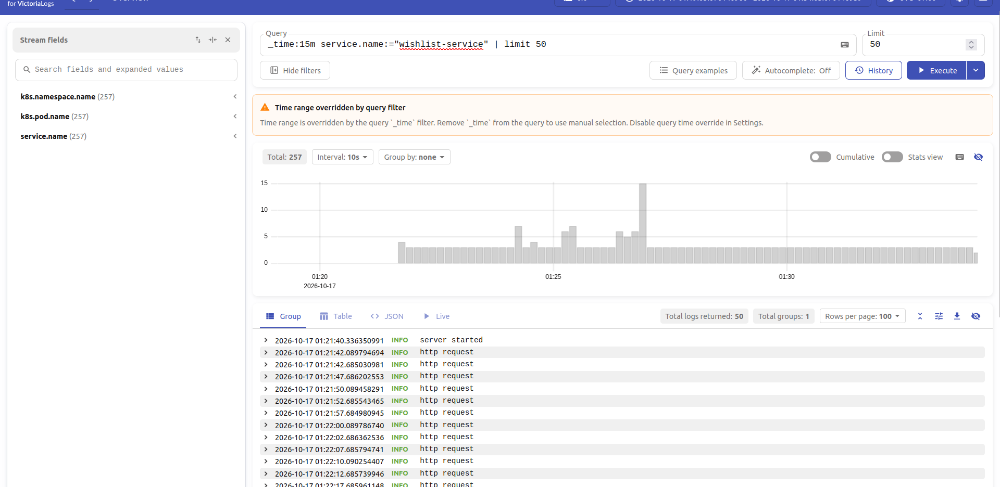
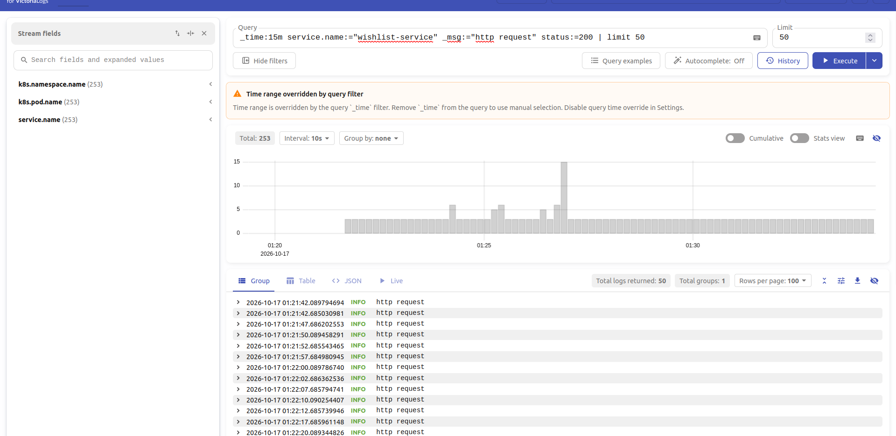
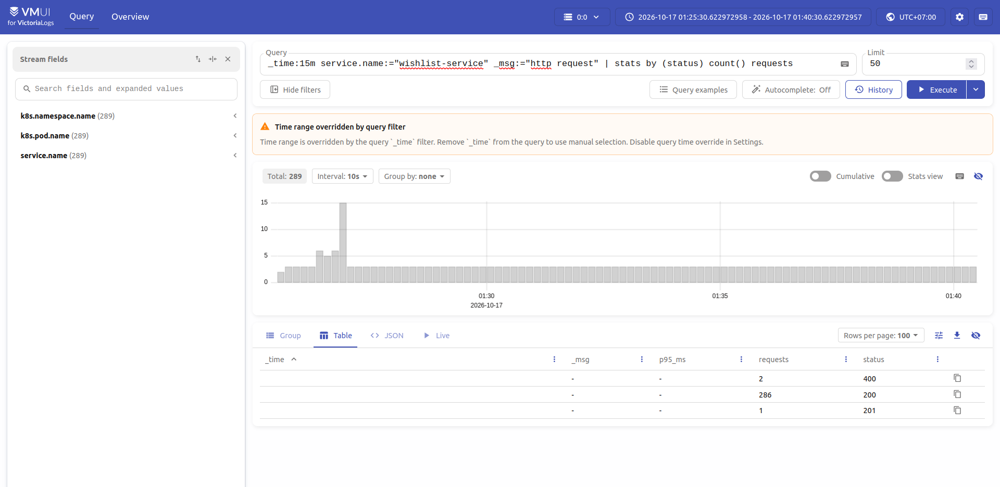
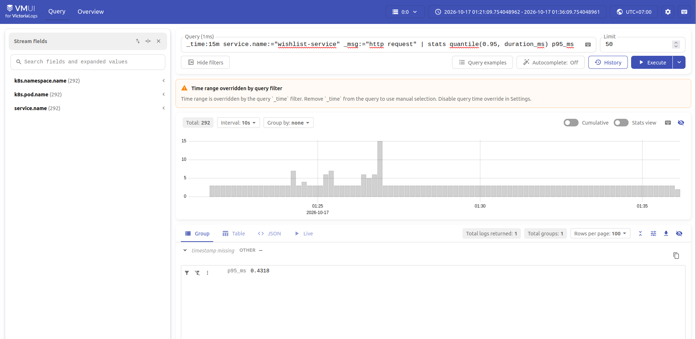
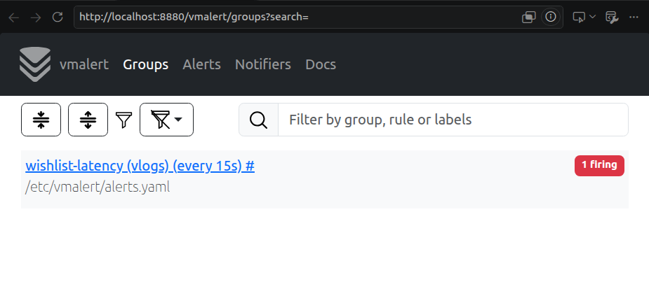

# Централизованное логирование wishlist-service

В кластере minikube `sre`, где работает wishlist-service, развёрнуты Victoria Logs single-node и сборщик Vector. Все компоненты находятся в namespace `wishlist`.

Victoria Logs версии `v1.53.0` запущена через Deployment с одной репликой. Для записей выделен PVC на 2 ГиБ, срок хранения — 7 дней. Внутри кластера хранилище доступно по адресу `http://victoria-logs:9428`, интерфейс vmui открывается через `kubectl port-forward`.

## Как доставляются логи

```text
wishlist-service → JSON в stdout → файлы логов на узле → Vector → Victoria Logs → vmui
```

Vector версии `0.54.0` запущен через DaemonSet: по одному сборщику на каждом Linux-узле. Он читает логи Pods с меткой `app=wishlist-service` в namespace `wishlist`, разбирает JSON и отправляет записи в ES-bulk endpoint Victoria Logs. В конфиге `message` сопоставлен с `_msg`, а `timestamp` — с `_time`.

DaemonSet выбран потому, что файлы логов находятся на узлах Kubernetes. Один сборщик читает логи всех нужных Pods на своём узле: при увеличении числа реплик приложения отдельные сборщики для них добавлять не требуется. Приложение продолжает писать в stdout, а сбор и отправка настраиваются независимо от его кода.

Vector подходит для этой задачи: источник `kubernetes_logs` читает контейнерные логи и добавляет сведения о Pods, преобразование `remap` разбирает JSON, а выход `elasticsearch` отправляет записи в совместимый endpoint Victoria Logs. Все три этапа задаются одним конфигом. Дополнительный сервис для обработки логов не нужен.

Приложение пишет время в UTC, уровень, сообщение, имя и версию сервиса, окружение. У HTTP-запросов есть `request_id`, метод, шаблон маршрута, статус и числовая длительность `duration_ms`. Ответы 2xx/3xx логируются как INFO, 4xx — WARN, 5xx — ERROR. Vector добавляет имя Pod, namespace, узла и контейнера.

Пример записи из stdout контейнера, полученной через `kubectl logs`:

```json
{
  "timestamp": "2026-10-16T18:21:42.018859805Z",
  "level": "INFO",
  "message": "http request",
  "service.name": "wishlist-service",
  "service.version": "k8s-v1",
  "deployment.environment.name": "minikube",
  "request_id": "55d12dbf-d774-4574-99b3-74d0b5129208",
  "method": "GET",
  "route": "/",
  "status": 200,
  "duration_ms": 1.008101
}
```

Для читаемости пример разбит на строки; в stdout каждое событие записывается одной JSON-строкой. После доставки в vmui также проверены поля `k8s.pod.name`, `k8s.namespace.name`, `k8s.node.name` и `k8s.container.name`.

Манифесты и конфиг сборщика находятся в [victoria-logs.yaml](victoria-logs.yaml) и [vector.yaml](vector.yaml), полная последовательность запуска — в [README.md](README.md).

## Запросы в vmui

### 1. Сырые записи за последние 15 минут

```text
_time:15m service.name:="wishlist-service" | limit 50
```

Показывает до 50 записей приложения за последние 15 минут. Используется для просмотра событий и проверки доставки. На скриншоте найдено 257 записей, показано 50, среди них запуск сервера и HTTP-запросы.



### 2. Фильтр по HTTP-статусу

```text
_time:15m service.name:="wishlist-service" _msg:="http request" status:=200 | limit 50
```

Выбирает только записи HTTP-запросов со статусом 200. Показывает, как искать события по отдельному полю. На скриншоте найдено 253 подходящие записи, показано 50.



### 3. Количество запросов по HTTP-статусу

```text
_time:15m service.name:="wishlist-service" _msg:="http request" | stats by (status) count() requests
```

Группирует HTTP-запросы по статусу и считает количество в каждой группе. Помогает увидеть распределение успешных и ошибочных ответов. На скриншоте в режиме Table показаны три группы: 286 запросов со статусом 200, один со статусом 201 и два со статусом 400 — всего 289 запросов.



### 4. p95 времени обработки HTTP-запросов

```text
_time:15m service.name:="wishlist-service" _msg:="http request" | stats quantile(0.95, duration_ms) p95_ms
```

Считает 95-й процентиль длительности: примерно 95% запросов обработано не дольше этого значения. На скриншоте `p95_ms=0.4318`, то есть около 0.432 мс. В выборку входят и проверки Kubernetes, обращающиеся к `/`; это результат текущего стенда, а не нагрузочного тестирования.



Запросы выполнены последовательно, поэтому их 15-минутные окна и количество записей различаются. Плашка `Time range overridden by query filter` означает, что интервал задан через `_time:15m`. У результатов `stats` нет времени отдельного события и уровня логирования, поэтому в режиме Group vmui показывает `timestamp missing / OTHER`.

## Бонус: алерт на высокую задержку API

В [vmalert.yaml](vmalert.yaml) настроено правило `WishlistHighLatency` на основе запроса p95. Каждые 15 секунд vmalert проверяет время обработки API-запросов за последние 5 минут. Если p95 превышает учебный порог 500 мс непрерывно в течение минуты, алерт переходит в `Firing`. Проверки Kubernetes на `/` в выборку не входят.

Для проверки я временно снизил порог до 0 мс и отправил реальный API-запрос. Алерт перешёл из `Inactive` в `Pending`, затем в `Firing`, что видно на скриншоте. Это проверка срабатывания при сниженном пороге, а не реальная деградация приложения. После проверки я вернул порог к 500 мс.



Используется режим `-notifier.blackhole`: правило вычисляется и его состояние доступно в UI, но внешние уведомления не отправляются. Grafana и Alertmanager не развёрнуты.
